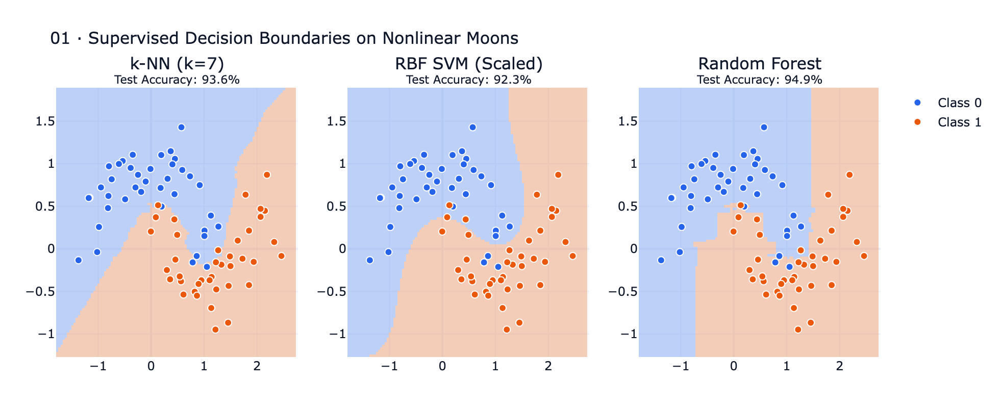
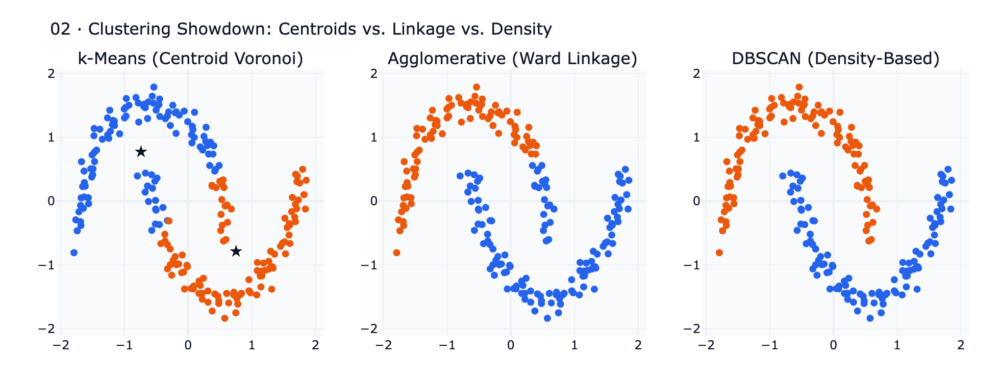
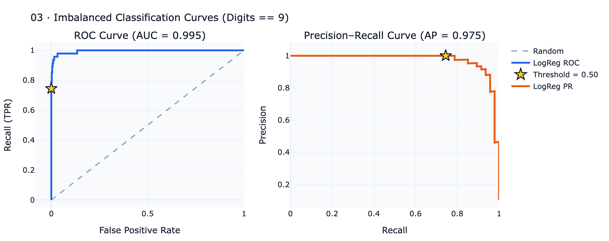
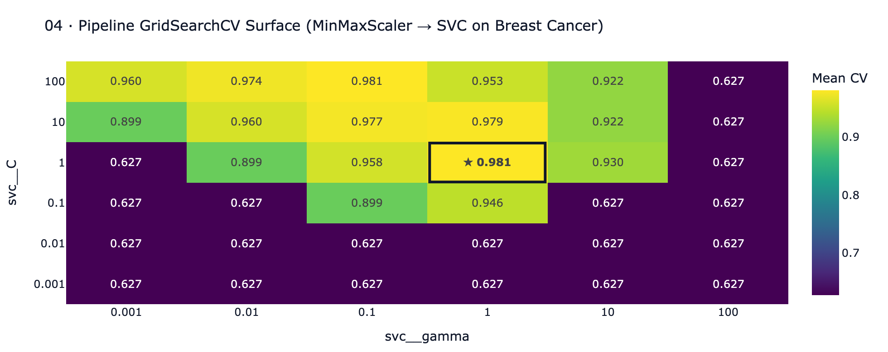
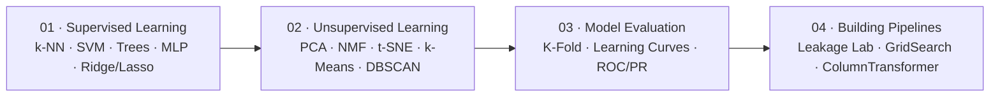

<div align="center">

# machine-learning-demo

**Interactive, visual machine learning labs built with [Marimo](https://marimo.io/), [scikit-learn](https://scikit-learn.org/), [Plotly](https://plotly.com/python/), and [uv](https://docs.astral.sh/uv/).**

Explore decision boundaries, dimensionality reduction, cross-validation pitfalls, and leak-free pipelines with live sliders and interactive charts—locally or directly in your browser with zero setup.

[](https://newguy012.github.io/machine-learning-demo/)
[](https://www.python.org/)
[](https://docs.astral.sh/uv/)
[](https://marimo.io/)
[](https://scikit-learn.org/)
[](LICENSE)

[Launch Browser Labs](https://newguy012.github.io/machine-learning-demo/) · [Quick Start](#quick-start-with-uv) · [Notebook Catalog](#interactive-notebook-catalog) · [Algorithm Cheat Sheet](#ml-algorithm-cheat-sheet)

</div>

---

## Visual Preview

| Supervised Boundaries & Scaling | Unsupervised Clustering Showdown |
| :---: | :---: |
|  |  |
| **Imbalanced Threshold Curves** | **Pipeline GridSearchCV Landscape** |
|  |  |

---

## Why Marimo?

- **Zero hidden state:** Every notebook is a deterministic reactive DAG—moving a slider updates every dependent stat card, Plotly chart, and coaching callout automatically.
- **Git-friendly pure Python:** Notebooks live as clean `.py` files with PEP 723 inline dependencies rather than noisy JSON `.ipynb` blobs.
- **One source, three ways to run:** Open as a code-first notebook (`marimo edit`), serve as an interactive web app (`marimo run`), or launch zero-install WebAssembly demos in your browser via GitHub Pages.

---

## Interactive Learning Path



## Interactive Notebook Catalog

| Notebook | Interactive Labs & Concepts | Datasets | Launch Locally (`uv`) | Browser Demo |
| :--- | :--- | :--- | :--- | :--- |
| [**01 · Supervised Learning**](notebooks/01_supervised_learning.py) | Iris SPLOM & feature explorer, $k$-NN decision contours & complexity curve, Breast Cancer SVM scaling collapse & ringed support vectors, Trees vs. Random Forest vs. GBDT, 8-classifier showdown (Linear, Naive Bayes, MLP), and Polynomial Ridge/Lasso | Iris, Breast Cancer, Moons, Circles, XOR, Blobs | `uv run marimo edit --no-sandbox notebooks/01_supervised_learning.py` | [Open Lab](https://newguy012.github.io/machine-learning-demo/01_supervised_learning/) |
| [**02 · Unsupervised Learning**](notebooks/02_unsupervised_learning.py) | Scaled vs. unscaled 2D/3D PCA + loadings heatmap, NMF parts-based strokes vs. PCA eigen-digits, t-SNE perplexity explorer, DBSCAN core/border/noise playground, and $k$-Means vs. Agglomerative (dendrogram) vs. DBSCAN | Breast Cancer, Digits, Moons, Circles, Blobs | `uv run marimo edit --no-sandbox notebooks/02_unsupervised_learning.py` | [Open Lab](https://newguy012.github.io/machine-learning-demo/02_unsupervised_learning/) |
| [**03 · Model Evaluation**](notebooks/03_model_evaluation.py) | Fold split matrix exposing unshuffled `KFold` 0% collapse on Iris, learning & validation curves, 2D `GridSearchCV` surface, Accuracy Paradox (`DummyClassifier`), synced ROC/PR threshold slider, and misclassified digit gallery | Iris, Breast Cancer, Digits (`== 9`) | `uv run marimo edit --no-sandbox notebooks/03_model_evaluation.py` | [Open Lab](https://newguy012.github.io/machine-learning-demo/03_model_evaluation/) |
| [**04 · Building Pipelines**](notebooks/04_building_pipelines.py) | Interactive Pipeline Builder with live scikit-learn HTML diagrams, Data Leakage Simulator on high-dimensional noise, `GridSearchCV` heatmap + multi-model pipeline search, and mixed-type `ColumnTransformer` | Breast Cancer, High-Dim Noise, Synthetic Tabular | `uv run marimo edit --no-sandbox notebooks/04_building_pipelines.py` | [Open Lab](https://newguy012.github.io/machine-learning-demo/04_building_pipelines/) |

---

## Quick Start with `uv`

If you don't have `uv` yet, install it once from [docs.astral.sh/uv](https://docs.astral.sh/uv/getting-started/installation/):

```bash
curl -LsSf https://astral.sh/uv/install.sh | sh
```

### 1. Clone and sync the locked environment

```bash
git clone https://github.com/NewGuy012/machine-learning-demo.git
cd machine-learning-demo
uv sync
```

`uv` reads `.python-version` (`3.15`) and `uv.lock` to provision the exact environment automatically—no manual `venv` activation needed.

### 2. Launch the notebooks

- **Notebook Edit Mode** *(read & tweak Python cells alongside interactive plots)*:
  ```bash
  uv run marimo edit notebooks/
  ```
- **Interactive App Mode** *(clean UI focused on sliders and visualizations)*:
  ```bash
  uv run marimo run --no-sandbox notebooks/01_supervised_learning.py
  ```
- **Run a single notebook standalone via `uvx`** *(uses inline `# /// script` metadata without cloning into a project venv)*:
  ```bash
  uvx marimo edit --sandbox notebooks/01_supervised_learning.py
  ```

> **Note for Zero-Install Browser Hosting:** Pushing to `master` triggers [`.github/workflows/deploy-pages.yml`](.github/workflows/deploy-pages.yml), which builds all four notebooks into static Pyodide WASM apps via `uv run python scripts/build_site.py`. In GitHub repository settings, set **Pages → Build and deployment → Source** to **GitHub Actions**.

---

## ML Algorithm Cheat Sheet

<details>
<summary><strong>Supervised Learning Algorithms — Pros, Cons & Scaling Rules</strong></summary>

| Algorithm | Tasks | Scaling Required? | Strengths | Watch Out For | Key Hyperparameters |
| :--- | :--- | :--- | :--- | :--- | :--- |
| **k-Nearest Neighbors** | Class / Reg | Yes | Simple baseline, non-parametric, zero training time | Slow inference on large datasets; degrades in high dimensions | `n_neighbors`, `weights`, `metric` |
| **Linear Models** (`Ridge`, `Lasso`, `LogisticRegression`) | Class / Reg | Yes | Fast, interpretable weights, scales to huge sparse data | Only linear decision boundaries unless features are engineered | `alpha` (Ridge/Lasso), `C` (LogReg) |
| **Naive Bayes** | Class | No | Extremely fast, strong text & high-dimensional baseline | Assumes conditional independence across features | `alpha`, `var_smoothing` |
| **Decision Trees** | Class / Reg | No | Interpretable rules, immune to monotonic feature scaling | High variance; overfits easily without depth/leaf pruning | `max_depth`, `min_samples_leaf` |
| **Random Forests** | Class / Reg | No | High out-of-the-box accuracy, parallelizable, low tuning | Larger memory footprint; slower single-row inference | `n_estimators`, `max_depth`, `max_features` |
| **Gradient Boosted Trees** | Class / Reg | No | Top tabular accuracy, compact fast predictions | Sequential training; sensitive to `learning_rate` & depth | `n_estimators`, `learning_rate`, `max_depth` |
| **Kernelized SVMs** (`SVC` / `SVR`) | Class / Reg | **Yes (Critical)** | Expressive smooth nonlinear boundaries on medium datasets | Poor scaling beyond ~50k rows; sensitive to `C`, `gamma`, scaling | `kernel`, `C`, `gamma` |
| **Neural Networks** (`MLP`) | Class / Reg | **Yes (Critical)** | Learns hierarchical nonlinear representations | Requires more data, tuning, and careful regularization | `hidden_layer_sizes`, `alpha`, `activation` |

</details>

<details>
<summary><strong>Unsupervised Learning Algorithms — Transformations & Clustering</strong></summary>

| Method | Category | Scaling Required? | Strengths | Watch Out For | Key Hyperparameters |
| :--- | :--- | :--- | :--- | :--- | :--- |
| **PCA** | Transformation | **Yes (Critical)** | Fast orthogonal compression with exact variance ratios | Linear projections only; mixed positive/negative weights | `n_components` |
| **NMF** | Transformation | Non-negative ($\ge 0$) | Additive, interpretable parts (pen strokes, topics) | Requires non-negative inputs; depends on initialization | `n_components`, `init` |
| **t-SNE** | Manifold Viz | Yes | Uncovers complex local cluster structure in 2D | Slow on large $N$; no `.transform()`; global distances distort | `perplexity`, `learning_rate` |
| **k-Means** | Clustering | Yes | Fast, scalable, exposes explicit cluster centroids | Assumes spherical convex clusters; requires choosing $k$ | `n_clusters` |
| **Agglomerative** | Clustering | Yes | Full hierarchical dendrogram; flexible linkage shapes | $O(N^2)$ memory/compute; cannot `.predict()` unseen points | `n_clusters`, `linkage` |
| **DBSCAN** | Clustering | Yes | Discovers arbitrary non-convex shapes; flags outliers (`-1`) | Struggles when clusters have vastly different densities | `eps`, `min_samples` |

</details>

<details>
<summary><strong>Model Evaluation & Pipeline Best Practices</strong></summary>

- **Cross-Validation:** Always prefer `StratifiedKFold` (or shuffled splits) for classification; unshuffled `KFold` fails catastrophically on class-ordered datasets like Iris.
- **3-Way Separation:** Fit preprocessing and tune hyperparameters solely inside CV folds on the training split—touch the held-out test set **only once** at the end.
- **Imbalanced Data:** Never trust raw accuracy alone; inspect confusion matrices, `Precision–Recall` (Average Precision), `F1`, and tune probability thresholds to match business error costs.
- **Pipelines:** Wrap every scaler, imputer, encoder, and feature selector inside `Pipeline` / `ColumnTransformer` so `.fit()` never sees validation fold distributions.

</details>

---

## Project Structure & Dev Commands

```text
machine-learning-demo/
├── .github/workflows/deploy-pages.yml   # Automated GitHub Pages WASM deployment
├── assets/                              # High-DPI preview PNGs for README
├── notebooks/
│   ├── 01_supervised_learning.py        # Interactive supervised learning labs
│   ├── 02_unsupervised_learning.py      # Interactive unsupervised learning labs
│   ├── 03_model_evaluation.py           # Interactive CV, GridSearch & imbalanced metrics
│   └── 04_building_pipelines.py         # Interactive pipelines, leakage & ColumnTransformer
├── scripts/
│   ├── build_site.py                    # Exports all notebooks via `marimo export html-wasm`
│   └── generate_assets.py               # Regenerates static README visuals in assets/
├── tests/
│   └── test_smoke.py                    # Minimal zero-dependency unittest smoke & integrity checks
├── .python-version                      # Pins Python 3.15 for uv
├── pyproject.toml                       # Project dependencies, dev/assets groups & Ruff settings
├── uv.lock                              # Deterministic lockfile
├── LICENSE                              # BSD 3-Clause License
└── README.md
```

Common developer checks (all powered by `uv`):

```bash
uv run marimo check --strict notebooks/*.py       # Validate Marimo DAGs & formatting
uv run ruff check . && uv run ruff format --check . # Lint & style checks (locked Ruff)
uv run python -m unittest discover -s tests -v    # Run minimal smoke & integrity tests
uv run python scripts/build_site.py               # Build static WASM site locally into _site/
uv run python -m http.server -d _site             # Preview the built WASM site locally
uv run --group assets python scripts/generate_assets.py  # Regenerate README preview PNGs
```

---

## Credits & License

- **Pedagogical Inspiration:** Adapted and expanded from [*Introduction to Machine Learning with Python*](https://www.oreilly.com/library/view/introduction-to-machine/9781449369880/) by **Andreas C. Müller** and **Sarah Guido**.
- **Built With:** [Marimo](https://marimo.io/), [scikit-learn](https://scikit-learn.org/), [Plotly](https://plotly.com/python/), [NumPy](https://numpy.org/), [SciPy](https://scipy.org/), and [uv](https://docs.astral.sh/uv/).
- **License:** Distributed under the [BSD 3-Clause License](LICENSE).
